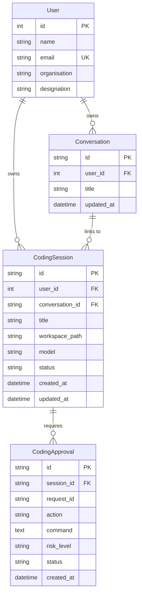

# Shield AI: Deep Agents Backend Integration Report

## 1. Overview & Objective

This document provides a comprehensive record of the implementation that merged the **Deep Agents** autonomous software engineering harness into the existing **Shield AI FastAPI backend** on git branch `coding-agent-implementation`.

In strict accordance with the core directive:
> **"Integrate, don't duplicate. The right approach is not to create a separate coding application. The coding agent experience becomes a Mode/Workspace inside the existing application, sharing authentication, users, database, conversations, model configuration, and API infrastructure."**

All capabilities were integrated into the primary backend without introducing a secondary server, secondary database, or parallel authentication system.

---

## 2. Inventory of Changes & Files

### A. New Files Created

| File Path | Description |
|---|---|
| [`backend/app/models/coding.py`](file:///d:/sih/project/backend/app/models/coding.py) | SQLAlchemy database models: `CodingSession` and `CodingApproval`. |
| [`backend/app/schemas/coding.py`](file:///d:/sih/project/backend/app/schemas/coding.py) | Pydantic validation schemas for sessions, file tree, file CRUD, terminal, and approvals. |
| [`backend/app/services/coding_workspace.py`](file:///d:/sih/project/backend/app/services/coding_workspace.py) | Path-jailed workspace file service (recursive tree, read/write/delete/rename, git status/diff). |
| [`backend/app/services/coding_terminal.py`](file:///d:/sih/project/backend/app/services/coding_terminal.py) | Terminal execution service inside workspace root, with per-session working directory tracking. |
| [`backend/app/services/coding_runner.py`](file:///d:/sih/project/backend/app/services/coding_runner.py) | Deep Agents session runner (`create_deep_agent` + `LocalShellBackend` + LangGraph `astream_events` v2). |
| [`backend/app/routers/coding.py`](file:///d:/sih/project/backend/app/routers/coding.py) | REST API endpoints under `/api/coding/...` and real-time streaming WebSocket `/ws/coding`. |

### B. Existing Files Modified

| File Path | Description of Changes |
|---|---|
| [`backend/app/models/user.py`](file:///d:/sih/project/backend/app/models/user.py) | Added `coding_sessions = relationship("CodingSession", back_populates="user", cascade="all, delete-orphan")`. |
| [`backend/app/models/chat.py`](file:///d:/sih/project/backend/app/models/chat.py) | Added `coding_sessions = relationship("CodingSession", back_populates="conversation")` to link chat conversations with coding sessions. |
| [`backend/app/database.py`](file:///d:/sih/project/backend/app/database.py) | Registered `CodingSession` and `CodingApproval` in `init_db()` so tables are auto-created at startup. |
| [`backend/app/repositories.py`](file:///d:/sih/project/backend/app/repositories.py) | Implemented `CodingRepository` providing CRUD methods for sessions and approval records. |
| [`backend/app/core/security.py`](file:///d:/sih/project/backend/app/core/security.py) | Added `get_user_from_token()` helper for WebSocket query-token authentication. |
| [`backend/app/main.py`](file:///d:/sih/project/backend/app/main.py) | Included `coding.router` and registered `/ws/coding` WebSocket streaming endpoint. |
| [`backend/app/agent/subagents/coding_agent.py`](file:///d:/sih/project/backend/app/agent/subagents/coding_agent.py) | Upgraded from naive single-shot script executor to full Deep Agents harness with sandbox fallback. |
| [`backend/app/agent/delegation.py`](file:///d:/sih/project/backend/app/agent/delegation.py) | Routed coding tasks into the user's sandboxed `/workspace/users/{user_id}/code` directory. |
| [`backend/pyproject.toml`](file:///d:/sih/project/backend/pyproject.toml) | Added editable dependency `deepagents` pointing to `../deepagents/libs/deepagents`. |

---

## 3. Database Architecture & Schema Extensions

Existing database tables (`users`, `conversations`, `messages`, `long_term_memories`) were preserved. Two new entities were added to the existing SQLite database via SQLAlchemy:



### Table Details:
1. **`coding_sessions`**:
   - `id`: UUID string (primary key)
   - `user_id`: Foreign key to `users.id` (cascade delete)
   - `conversation_id`: Optional foreign key to `conversations.id` (set null on delete). Allows transitioning directly from a chat discussion into a coding workspace.
   - `workspace_path`: Path on disk where the session's files live.
   - `model`: Target LLM model spec.
   - `status`: Lifecycle state (`idle`, `thinking`, `executing`, `waiting_approval`, `completed`, `error`).
2. **`coding_approvals`**:
   - Records human-in-the-loop permission requests triggered by sensitive tools (`execute`, dangerous commands) and tracks approval decisions (`pending`, `approved`, `rejected`).

---

## 4. Workspace & Path-Jailed Filesystem Service

Implemented in [`app/services/coding_workspace.py`](file:///d:/sih/project/backend/app/services/coding_workspace.py):

* **User Workspace Isolation**: User workspaces default to `backend/workspace/users/{user_id}/code`.
* **Path Traversal Defense**: All path operations validate that the resolved path is strictly relative to the permitted workspace boundary (`resolve_safe_file_path`). Any attempt to escape via `..` or absolute paths raises `HTTP 403 Forbidden`.
* **Recursive File Tree**: Generates clean recursive file trees up to 5 levels deep, sorting directories before files and filtering build noise (`.git`, `node_modules`, `__pycache__`, `.venv`, `.pytest_cache`, `dist`, `build`, etc.).
* **File Operations**: Provides UTF-8 read, write (auto-creating parent folders), delete, and rename endpoints.
* **Git Diagnostics**: When the workspace contains a `.git` repository, runs `git rev-parse`, `git status --porcelain`, and `git diff` to provide live git telemetry to the editor.

---

## 5. Integrated Terminal Execution Service

Implemented in [`app/services/coding_terminal.py`](file:///d:/sih/project/backend/app/services/coding_terminal.py):

* **Workspace Shell Execution**: Runs commands directly in the host shell within the active workspace root.
* **Per-Session CWD Tracking**: Maintains working directory state across consecutive commands.
* **Built-In Shell Handling**:
  * `clear` / `cls`: Emits standard ANSI terminal reset sequences (`\x1b[2J\x1b[H`).
  * `cd <relative_path>`: Safely validates that target directory exists and does not escape workspace root before updating session CWD.
* **Timeout Protection**: Spawns subprocesses with a default 60-second execution cap to prevent runaway processes.

---

## 6. Deep Agents Runner Engine

Implemented in [`app/services/coding_runner.py`](file:///d:/sih/project/backend/app/services/coding_runner.py):

* **Direct SDK Integration**: Utilizes `from deepagents import create_deep_agent` and `from deepagents.backends import LocalShellBackend`.
* **Host Workspace Mount**: Mounts `LocalShellBackend(root_dir=workspace_dir, inherit_env=True)`. The agent sees the workspace root mounted as `/` and has access to built-in tools:
  * `ls`, `read_file`, `write_file`, `edit_file`, `glob`, `grep`, and `execute`.
* **Model Resolution**: Resolves chat models dynamically:
  * Mistral Cloud API (`ministral-3b-latest`) if configured with `MISTRAL_API_KEY`.
  * Local Ollama (`ministral-3:3b`, etc.) as default sovereign provider.
  * Google Gemini, OpenAI GPT, Anthropic Claude when specified.
* **Autonomous Operating Prompt**: Instructs the agent to proactively inspect code, make surgical edits with `edit_file`, test implementations via `execute`, and present concise summaries.
* **Event Streaming via LangGraph `astream_events(v2)`**:
  * Emits streaming token chunks (`agent_chunk`) during LLM generation.
  * Emits tool lifecycle events (`tool_started` and `tool_finished`) with durations and bounded output previews.
  * Automatically emits `file_changed` when `write_file`, `edit_file`, or `execute` alters files, alerting the frontend to refresh the file explorer and Monaco editor.
  * Supports interactive pause/resume via `Command(resume={"approved": ...})`.

---

## 7. REST & WebSocket API Reference

Mounted under prefix `/api/coding` and `/ws/coding` in [`app/main.py`](file:///d:/sih/project/backend/app/main.py):

### REST APIs (`/api/coding/...`)

| Method | Endpoint | Description |
|---|---|---|
| `POST` | `/api/coding/sessions` | Create a new coding session for authenticated user. |
| `GET` | `/api/coding/sessions` | List all coding sessions for authenticated user. |
| `GET` | `/api/coding/sessions/{id}` | Get session details and approval history. |
| `DELETE` | `/api/coding/sessions/{id}` | Delete a coding session. |
| `GET` | `/api/coding/workspace/tree` | Fetch recursive file tree (`?session_id=...`). |
| `GET` | `/api/coding/workspace/file` | Read file content (`?path=...&session_id=...`). |
| `POST` | `/api/coding/workspace/file` | Write / save file content (`path`, `content`). |
| `DELETE` | `/api/coding/workspace/file` | Delete file or folder (`?path=...`). |
| `PATCH` | `/api/coding/workspace/file` | Rename file or folder (`old_path`, `new_path`). |
| `GET` | `/api/coding/workspace/git` | Return git branch, status, and diff. |
| `GET` | `/api/coding/workspace/active` | Get active workspace root path. |
| `GET` | `/api/coding/terminal/info` | Get terminal current directory and status. |
| `POST` | `/api/coding/terminal/exec` | Execute shell command in workspace (`command`, `cwd`). |
| `POST` | `/api/coding/approval` | Submit human approval decision (`request_id`, `decision`). |

### WebSocket Gateway (`/ws/coding` and `/api/coding/ws`)

Authenticates using `?token=<jwt>` query parameter or through the first JSON frame.

#### Client Messages Sent to Backend:
```json
// Prompt:
{"type": "prompt", "session_id": "session-123", "text": "Create a FastAPI health endpoint", "model": "default"}

// Approval Response:
{"type": "approval_response", "session_id": "session-123", "request_id": "req-1", "decision": "approve"}

// Stop Execution:
{"type": "stop", "session_id": "session-123"}

// Reset Session:
{"type": "reset", "session_id": "session-123"}
```

#### Server Events Streamed to Frontend:
```json
// Status:
{"type": "agent_status", "status": "thinking"}

// Streamed token chunk:
{"type": "agent_chunk", "session_id": "session-123", "content": "I'll create the endpoint file."}

// Tool call started:
{"type": "tool_started", "tool": "write_file", "tool_id": "run-456", "args": {"file_path": "/health.py"}}

// Tool call finished:
{"type": "tool_finished", "tool": "write_file", "tool_id": "run-456", "duration_ms": 42, "output": "File written"}

// File changed on disk:
{"type": "file_changed", "path": "health.py", "change_type": "modified"}

// Human approval required:
{"type": "approval_required", "request_id": "req-1", "action": "execute", "command": "pip install fastapi"}

// Agent turn completed:
{"type": "agent_completed", "session_id": "session-123"}
```

---

## 8. Subagent Upgrade (`app/agent/subagents/coding_agent.py`)

The existing chatbot supervisor delegates queries with `intent == "coding"` through [`app/agent/delegation.py`](file:///d:/sih/project/backend/app/agent/delegation.py). 

`run_coding_agent` was upgraded from a single-shot markdown script extractor into an autonomous ReAct subagent powered by Deep Agents:
1. Mounts `LocalShellBackend` to `backend/workspace/users/{user_id}/code`.
2. Assembles `create_deep_agent` with the model and checkpointer.
3. Allows the subagent to autonomously inspect files, perform surgical edits, and test code.
4. Preserves graceful fallback to `SandboxExecutor` in the event of any remote dependency failure.

---

## 9. Verification & Live Status

* **Dependency Installation**: `deepagents==0.7.17`, `langchain-anthropic`, and `langchain-google-genai` installed into `backend/.venv` in editable mode pointing directly to [`deepagents/libs/deepagents`](file:///d:/sih/project/deepagents/libs/deepagents).
* **Bytecode Compilation**: `python -m py_compile` executed across all new and modified modules with return code 0.
* **Live Server Endpoint Validation**:
  * `GET http://localhost:8000/health` $\rightarrow$ `{"status": "online", "app": "Shield AI", "version": "1.0.0"}`
  * `GET http://localhost:8000/openapi.json` confirmed live registration of all 9 `/api/coding` REST paths and `/ws/coding` WebSocket.
