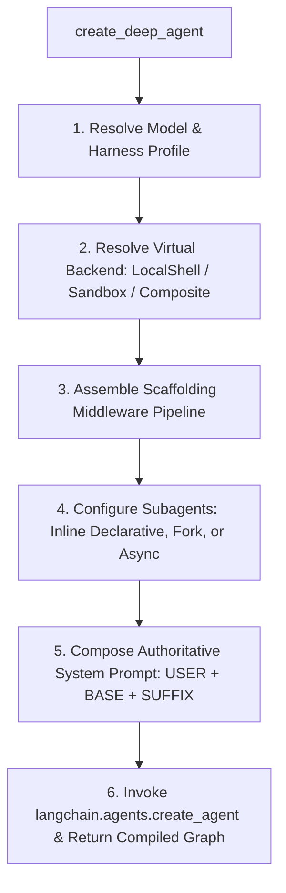

# Deep Agents & Coding Agent Architecture: Comprehensive Codebase Context

## 1. Executive Summary & Core Philosophy

**Deep Agents** is an open-source, batteries-included agent harness built by LangChain on top of **LangChain** (`create_agent`) and **LangGraph** (state, streaming, checkpointing, interrupts). It provides an opinionated, production-grade agent architecture tuned for **long-horizon, multi-step autonomous workflows** such as software engineering, coding assistance, repository maintenance, deep research, and multimodal operations.

### Origins & Lineage
The architecture of Deep Agents and its terminal coding companion `deepagents-code` (`dcode`) was directly inspired by systems like **Claude Code** and **Cursor**. The fundamental goal of the project was to deconstruct what makes frontier coding agents versatile, capable, and resilient, and package those primitives into an extensible, model-agnostic, open-source harness.

### Core Principles
1. **Opinionated Defaults**: Bundles planning, multi-backend virtual filesystem access, subagent delegation, automated context window compaction/summarization, and persistent memory out of the box.
2. **Extensible Without Forking**: Callers can override, replace, or wrap any layer (backends, middleware, tools, subagents, profiles) without altering internal engine code.
3. **Model-Agnostic**: Operates with any LLM supporting tool calling—frontier APIs (Anthropic Claude, OpenAI GPT, Google Gemini, Mistral), hosted open-weight models (Fireworks, Baseten, Together), or local engines (Ollama, vLLM, llama.cpp).
4. **Production-Ready Runtime**: Runs directly on LangGraph, enabling streaming token-by-token generation, durable SQLite/Postgres checkpointing, deterministic resume across sessions, and native Human-in-the-Loop (HITL) execution pauses.

---

## 2. Monorepo Structure & System Topology

The `deepagents` repository is a unified monorepo organized into libraries (`libs/`), applications (`apps/`), deployment examples (`examples/`), and evaluation harnesses:

```
deepagents/
├── libs/
│   ├── deepagents/           # Core SDK: create_deep_agent, middleware, backends, profiles
│   ├── code/                 # deepagents-code (dcode): Terminal coding agent & TUI
│   ├── acp/                  # Agent Client Protocol (ACP) server for Zed & external IDEs
│   ├── talon/                # Daemon host for background agents, cron, Telegram/Discord/WhatsApp
│   ├── evals/                # Evaluation framework (CLBench, Harbor, unified scorecards)
│   └── partners/             # Remote execution backends (Daytona, Modal, QuickJS, Runloop, Vercel)
├── apps/
│   ├── server/               # Antigravity Deep Agents IDE Gateway (FastAPI, WebSocket, Runner)
│   └── web/                  # React 18 + Vite + Monaco + XTerm Web IDE Frontend
├── examples/                 # Production agent patterns (coding agent, research, wiki, sql)
├── openwiki/                 # Auto-generated repository evidence and knowledge index
├── AGENTS.md                 # Contributor & agent development guidelines
└── action.yml / ACTION.md    # GitHub Actions integration for automated agent workflows
```

### The Three Architecture Layers
```
┌────────────────────────────────────────────────────────────────────────┐
│ Deep Agents: Opinionated Harness (Scaffolding, Backends, Profiles)    │
├────────────────────────────────────────────────────────────────────────┤
│ LangChain: Agent Abstraction (create_agent, Middleware, Tool Loop)     │
├────────────────────────────────────────────────────────────────────────┤
│ LangGraph: Graph Runtime (DeltaChannel State, Checkpoints, Interrupts) │
└────────────────────────────────────────────────────────────────────────┘
```

- **LangGraph**: Underlying engine executing the agent as a compiled state graph (`CompiledStateGraph`). Manages transitions, streaming channels, persistence, and interrupts.
- **LangChain `create_agent`**: Provides the core ReAct loop connecting the chat model, tools, and middleware hooks.
- **Deep Agents (`create_deep_agent`)**: Composes the entire operational harness—injecting virtual filesystems, planning subagents, skills, memory, and safety policies.

---

## 3. Deep Dive: Core SDK (`libs/deepagents`)

Located at `libs/deepagents/deepagents/`. This is the foundational library powering all coding agents and runners.

### 3.1. Agent Construction Flow (`graph.py:create_deep_agent`)

The main entry point is `create_deep_agent(...)`. When invoked, it executes the following six-stage pipeline:



#### Key Parameters of `create_deep_agent`:
- `model`: Target chat model (`BaseChatModel` instance or `"provider:model"` string).
- `backend`: Instance of `BackendProtocol` (defaults to in-memory `StateBackend`, or `LocalShellBackend` for host execution).
- `tools`: Additional user-defined tools appended to the built-in tool suite.
- `middleware`: Custom middleware sequence inserted into the pipeline.
- `subagents`: List of `SubAgent`, `CompiledSubAgent`, or `AsyncSubAgent` specifications.
- `skills`: Directory paths containing reusable `SKILL.md` skill definitions.
- `memory`: Path list for persistent instructions/memories (e.g. `AGENTS.md`).
- `permissions`: Fine-grained filesystem permission rules (`FilesystemPermission`).
- `checkpointer`: LangGraph checkpointer (e.g. `MemorySaver`, `AsyncSqliteSaver`).
- `interrupt_on`: Tool interruption mapping for Human-In-The-Loop approvals.

### 3.2. State Optimization: `DeepAgentState` & `DeltaChannel`
In standard LangGraph agents, message lists accumulate on every turn, causing checkpoint sizes to grow quadratically ($O(N^2)$). Deep Agents introduces:

```python
class DeepAgentState(AgentState):
    messages: Required[Annotated[list[AnyMessage], DeltaChannel(_messages_delta_reducer, snapshot_frequency=50)]]
```
`DeltaChannel` preserves deltas between steps rather than replicating the entire message array, taking snapshot compaction every 50 turns. This flattens checkpoint storage growth to $O(N)$.

### 3.3. Middleware Stack Architecture & Ordering

Middleware wraps the agent execution cycle before model calls, around tool executions, and during state preparation. The strict order of execution is:

```
1. Base Scaffolding Stack:
   ├── SkillsMiddleware (Discovers skills, injects skill catalogue into prompt)
   ├── FilesystemMiddleware (Mounts ls, read_file, write_file, edit_file, glob, grep, execute)
   ├── SubAgentMiddleware (Mounts task tool for synchronous subagent delegation)
   ├── SummarizationMiddleware (Compacts context window when token threshold exceeded)
   ├── PatchToolCallsMiddleware (Repairs malformed tool calls emitted by models)
   └── AsyncSubAgentMiddleware (Mounts tools for background/long-running subagent tasks)

2. Caller Custom Middleware (Injected user middleware)

3. Tail & Safety Stack:
   ├── Harness Profile extra_middleware
   ├── _ToolExclusionMiddleware (Excludes forbidden tools per model profile)
   ├── PromptCachingMiddleware (Anthropic, Bedrock, Fireworks cache breakpoints)
   ├── MemoryMiddleware (Injects AGENTS.md / long-term memory into prompt)
   └── HumanInTheLoopMiddleware (Pauses execution before sensitive tool calls)
```

#### Detailed Breakdown of Built-In Middleware:
- **`FilesystemMiddleware`**: Implements standard file operations (`ls`, `read_file`, `write_file`, `edit_file`, `glob`, `grep`). If the active backend implements `SandboxBackendProtocol`, it also mounts the `execute` tool for terminal commands. Enforces path permissions before executing file modifications.
- **`SubAgentMiddleware`**: Manages isolated subagent execution. When the model invokes the `task(subagent_name, prompt)` tool, the subagent runs within its own clean context window without cluttering the primary agent's history. Supports declarative agents (`SubAgent`), pre-compiled graphs (`CompiledSubAgent`), and parent conversation inheritance (`mode="fork"`).
- **`SkillsMiddleware`**: Scans configured directories for `SKILL.md` bundles, presents available skills to the model, and injects complete skill instructions only when activated.
- **`SummarizationMiddleware`**: Monitors message tokens. When approaching window boundaries, it triggers background summarization to consolidate historical dialogue while retaining active tool outputs and critical state.
- **`PatchToolCallsMiddleware`**: Fixes common model quirks (e.g. invalid JSON strings, missing required arguments, mismatched tool identifiers) before tool execution.

### 3.4. Backends: The Virtual Filesystem & Execution Engine

All file and execution operations are abstracted behind protocols defined in `deepagents.backends.protocol`:

```
BackendProtocol (Base)
├── read(path, offset, limit) -> ReadResult
├── write(path, content) -> WriteResult
├── edit(path, old_content, new_content) -> EditResult
├── list(path) -> LsResult
├── glob(pattern, path) -> GlobResult
└── grep(query, path, case_sensitive, regex) -> GrepResult

SandboxBackendProtocol (Extends BackendProtocol)
└── execute(command, timeout, cwd, env) -> ExecuteResponse (stdout, stderr, exit_code)
```

#### Implemented Backends:
1. **`LocalShellBackend`** (`backends/local_shell.py`):
   - Bridges the agent directly to the local host machine within a specified `root_dir`.
   - Filesystem operations are strictly path-jailed within the workspace root.
   - Command execution spawns native local processes via `asyncio.subprocess` or `subprocess.Popen`.
2. **`FilesystemBackend`** (`backends/filesystem.py`):
   - Direct disk I/O without shell execution capabilities.
3. **`StateBackend`** (`backends/state.py`):
   - Ephemeral in-memory filesystem stored within the LangGraph state. All files disappear when the graph state is deleted.
4. **`StoreBackend`** (`backends/store.py`):
   - Durable filesystem backed by LangGraph's persistent `BaseStore`. Files survive across multiple conversations and threads.
5. **`CompositeBackend`** (`backends/composite.py`):
   - Route-multiplexing backend. Routes file paths to different backends based on path prefixes:
     - `/workspace/...` $\rightarrow$ `LocalShellBackend` (disk)
     - `/memories/...` $\rightarrow$ `StoreBackend` (cross-thread persistence)
     - `/tmp/...` $\rightarrow$ `StateBackend` (ephemeral memory)
6. **Remote Sandbox Backends** (`backends/sandbox.py` & `partners/`):
   - Isolated remote execution containers: LangSmith Sandbox, Daytona, Modal, Runloop, QuickJS.

---

## 4. Deep Dive: Terminal Coding Agent (`libs/code` / `deepagents-code`)

`deepagents-code` (distributed under the CLI command `dcode`) is the complete terminal-based coding assistant.

```
libs/code/deepagents_code/
├── main.py                   # CLI entry point, startup lifecycle, trust workflows
├── agent.py                  # Agent construction, prompt assembling, skill resolution
├── app.py / app.tcss         # Textual TUI application (Reactive UI, diffs, tool cards)
├── tui/                      # Textual screens, modals, widgets, terminal adapters
├── config.py                 # Multi-tiered configuration resolution system
├── tools.py                  # Web search (Tavily), SSRF-guarded fetch_url, custom tools
├── managed_tools.py          # Auto-installer & SHA256 verification for ripgrep (rg)
├── approval_mode.py          # Security approval policies (AUTO, PROMPT, TRUST, MANUAL)
├── cost_tracking.py          # Live token tracking and model pricing calculator
├── sessions.py               # Conversation checkpointing and session resume engine
├── extensions/               # Server-side Python extension plugin system
├── hooks/                    # Lifecycle hook execution engine (hooks.json)
└── plugins/                  # Plugin discovery, store, and marketplace
```

### 4.1. Client / Server Decoupled Architecture
`deepagents-code` divides execution into two processes:
- **Terminal Client (Presentation & Input)**: Runs the Textual interactive TUI or headless runner. Captures keystrokes, handles user approvals, streams tokens, and formats diffs.
- **Agent Server (Runtime & Orchestration)**: Runs the LangGraph agent graph, coordinates LLM API communication, invokes local shell/sandbox tools, manages persistence, and streams event chunks back to the client over an IPC streaming channel.

### 4.2. Tool Suite & Tool Security
In addition to core filesystem and execution tools, `dcode` includes:
- **`ripgrep` Auto-Management (`managed_tools.py`)**: Checks for `rg` on `PATH`. If missing, securely downloads the pinned platform-specific binary (v14.1.1) from GitHub releases, validates its cryptographic SHA-256 hash, and mounts it into the execution environment.
- **SSRF-Guarded Web Tools (`tools.py`)**:
  - `web_search`: Live search powered by Tavily.
  - `fetch_url`: Downloads web content and converts it to markdown.
  - **SSRF Defense Architecture**:
    - Rejects private IP subnets (RFC 1918: `10.0.0.0/8`, `172.16.0.0/12`, `192.168.0.0/16`).
    - Rejects loopback (`127.0.0.0/8`), link-local, and cloud Instance Metadata Services (IMDS: `169.254.169.254`).
    - Unwraps IPv4-mapped IPv6 (`::ffff:127.0.0.1`) and 6to4 addresses (`2002::/16`).
    - Applies strict DNS pinning via an internal socket hook to prevent DNS rebinding attacks.

### 4.3. Security & Human-In-The-Loop Approval System
`dcode` enforces workspace-boundary trust:
1. **Workspace Trust Prompting**: On first launch in a new directory, prompts the operator to verify whether the repository is trusted.
2. **Approval Modes**:
   - `AUTO`: Automatically approves safe, non-destructive operations.
   - `PROMPT`: Prompts the user before executing shell commands (`execute`) or destructive filesystem edits.
   - `TRUST`: Elevated privileges for trusted local projects.
   - `MANUAL`: Every single tool invocation requires explicit confirmation.
3. **Risk Analysis**: Pre-execution scanner analyzes commands for dangerous patterns (`rm -rf /`, `curl | bash`, credential exfiltration) and prompts with high-severity visual warnings.

### 4.4. Configuration Hierarchy (`config.py`)
Configurations are evaluated in a strict five-tier hierarchy:
```
1. Hardcoded SDK Defaults
      ↓
2. Global User Settings (~/.deepagents/config.toml)
      ↓
3. Project-Specific Settings (./.deepagents/config.toml)
      ↓
4. Environment Variables (.env / os.environ)
      ↓
5. Runtime CLI Arguments (dcode --model ... --sandbox ...)
```
Configuration is stored in an **immutable process generation**. Modifying `config.toml` does not corrupt active readers; callers trigger atomic refreshes via `/reload`.

### 4.5. Skills, Hooks, and Extensions
- **Skills**: Discovered automatically from `~/.deepagents/skills/`, `./.deepagents/skills/`, and `./.claude/skills/`. Contains a `SKILL.md` file specifying frontmatter descriptions and operational guidelines.
- **Hooks (`HOOKS.md` / `hooks.json`)**: Intercepts agent events at lifecycle points:
  - `pre_command`: Runs validations or lints before commands execute.
  - `post_command`: Triggered after command execution (e.g. running test suites, recording telemetry).
  - `on_interrupt`: Handles agent pause states.
- **Extensions (`EXTENSIONS.md`)**: Python modules loaded at runtime to inject custom middleware, custom tools, or custom storage routes.

---

## 5. Antigravity IDE Gateway & Web UI (`apps/server` & `apps/web`)

The `apps/` directory provides a full web-based coding IDE that packages `deepagents` into a graphical browser environment similar to Cursor or VS Code Web.

```
apps/
├── server/                   # FastAPI Gateway Server
│   ├── server/
│   │   ├── main.py           # FastAPI entrypoint, CORS, router mounting
│   │   ├── gateway.py        # WebSocket /ws/agent streaming gateway
│   │   ├── agent_runner.py   # Agent session cache, create_deep_agent runner, event streamer
│   │   ├── workspace.py      # File tree, file CRUD, directory & git REST endpoints
│   │   ├── terminal.py       # PTY / local subprocess terminal execution service
│   │   └── config.py         # Workspace path resolution & environment settings
│   └── pyproject.toml        # Editable dependency on libs/deepagents
└── web/                      # React 18 + Vite Web Application
    ├── src/
    │   ├── components/
    │   │   ├── AgentPanel.tsx       # Real-time chat, tool execution tiles, approval modals
    │   │   ├── Editor.tsx           # Monaco code editor with multi-tab support & syntax
    │   │   ├── Explorer.tsx         # Workspace directory tree explorer
    │   │   ├── TerminalDrawer.tsx   # Integrated XTerm.js terminal connected to backend
    │   │   ├── Header.tsx           # Model selector, workspace status, navigation
    │   │   └── WorkspaceModal.tsx   # Workspace directory picker
    │   ├── services/
    │   │   └── agentWs.ts           # WebSocket client handling structured agent event stream
    │   └── stores/                  # Zustand state stores (agent, editor, workspace)
    └── package.json
```

### 5.1. Agent Streaming Protocol (WebSocket: `/ws/agent`)
The gateway communicates with the frontend over an asynchronous JSON event protocol:

| Event Type | Direction | Payload | Purpose |
|------------|-----------|---------|---------|
| `prompt` | Client $\rightarrow$ Server | `{"text": str, "model": str, "session_id": str}` | Submit user instruction |
| `agent_status` | Server $\rightarrow$ Client | `{"status": "thinking"\|"executing_tool"\|"idle"\|"error"}` | Update agent phase |
| `agent_chunk` | Server $\rightarrow$ Client | `{"content": str}` | Token-by-token LLM output |
| `tool_started` | Server $\rightarrow$ Client | `{"tool": str, "tool_id": str, "args": dict}` | Display tool call badge/card |
| `tool_finished` | Server $\rightarrow$ Client | `{"tool": str, "tool_id": str, "output": str, "duration_ms": int}` | Render tool execution result |
| `file_changed` | Server $\rightarrow$ Client | `{"path": str, "change_type": "modified"}` | Trigger frontend file tree & editor reload |
| `approval_required` | Server $\rightarrow$ Client | `{"request_id": str, "action": str, "command": str}` | Open approval prompt modal |
| `approval_response` | Client $\rightarrow$ Server | `{"decision": "approve"\|"reject", "request_id": str}` | Resume interrupted agent run |
| `stop` | Client $\rightarrow$ Server | `{"session_id": str}` | Cancel running agent task |
| `reset` | Client $\rightarrow$ Server | `{"session_id": str}` | Clear thread memory & start fresh session |

### 5.2. `agent_runner.py`: Streaming via `astream_events` (v2)
`AgentSession` configures `create_deep_agent` with:
- `backend=LocalShellBackend(root_dir=workspace_dir)`
- `checkpointer=MemorySaver()`
- Dynamic model resolution (Gemini, Claude, GPT, Mistral, Ollama)

During execution, `agent_runner.py` iterates over LangGraph's event stream:
- `on_chat_model_stream`: Extracts streamed token chunks and yields `agent_chunk`.
- `on_tool_start`: Emits `tool_started` with arguments.
- `on_tool_end`: Emits `tool_finished` with bounded output and duration; emits `file_changed` if file modification tools (`write_file`, `edit_file`, `execute`) were invoked.

---

## 6. Auxiliary Subsystems: Talon, ACP, Evals, Partners

### 6.1. `libs/acp` (Agent Client Protocol)
- Implements the [Agent Client Protocol (ACP)](https://agentclientprotocol.com/) specification.
- Exposes Deep Agents as an ACP server, allowing text editors such as **Zed** to embed the agent natively in their editor panels.
- Provides `dcode --acp` to turn the terminal coding agent into an ACP server with a single flag.

### 6.2. `libs/talon` (Autonomous Daemon Host)
- A long-running background host for agents operating outside interactive terminals.
- **Channel Adapters**: Native support for **Discord**, **Telegram**, and **WhatsApp** (via a loopback Node bridge).
- **Persistent Cron Scheduler**: Agent can register recurring jobs and background timers.
- **State Archiving**: Preserves conversation history in `checkpoints.sqlite`, MongoDB, or PostgreSQL, with session pagination and context reset (`/new`, `/reset-all-history`).

### 6.3. `libs/evals` (Benchmarking & Evaluation)
- Built on top of **CLBench** and **Harbor**.
- Runs automated suites evaluating code completion, debugging, multi-step refactoring, tool precision, and context retention across diverse model providers.

### 6.4. `libs/partners` (Cloud Sandboxes)
- Provides pluggable remote execution adapters for:
  - **Daytona**: Ephemeral development sandboxes.
  - **Modal**: Cloud serverless container execution.
  - **QuickJS**: Embedded JavaScript sandbox.
  - **Runloop**: Fast AI agent sandboxes.
  - **Vercel**: Serverless edge environments.

---

## 7. Comparative Blueprint: Shield AI vs. Deep Agents

In the current workspace repository (`d:\sih\project`), the backend has a prototype coding agent located at:
`d:\sih\project\backend\app\agent\subagents\coding_agent.py`

### Architectural Comparison

| Dimension | Current `coding_agent.py` | Deep Agents Architecture |
|---|---|---|
| **Execution Loop** | Single-shot prompt $\rightarrow$ extract markdown Python script $\rightarrow$ run in sandbox $\rightarrow$ retry on failure (max 2 retries). | Full autonomous ReAct loop with multi-tool calling, step-by-step verification, and dynamic recovery. |
| **Tool Surface** | Only runs monolithic Python scripts inside `SandboxExecutor`. | Full virtual filesystem: `ls`, `read_file`, `write_file`, `edit_file`, `glob`, `grep`, plus terminal `execute`. |
| **Filesystem Interaction** | Entire script must be written and executed to inspect or touch files. | Targeted incremental tools (e.g. `read_file` line offsets, `edit_file` string replacement, `grep` search). |
| **Execution Environment** | Fixed sandbox process via `SandboxExecutor`. | Pluggable backends: `LocalShellBackend` (host workspace), remote sandboxes (LangSmith, Modal, Daytona), or `CompositeBackend`. |
| **Streaming & Telemetry** | Monolithic execution block; no real-time token or tool-call events. | Fine-grained event streaming (`astream_events` v2: `agent_chunk`, `tool_started`, `tool_finished`, `file_changed`). |
| **Context Management** | Script and error traceback simply appended to user prompt; token overflow risk. | `SummarizationMiddleware`, `DeltaChannel` state checkpointing, and tool output offloading. |
| **Human-in-the-Loop** | Not supported; executions run automatically. | Native `HumanInTheLoopMiddleware` with granular approval policies (`AUTO`, `PROMPT`, `TRUST`, `MANUAL`). |
| **Extensibility** | Fixed prompt template. | Declarative `SubAgent` delegation, modular `SKILL.md` skills, lifecycle hooks, and Python extensions. |

### Migration & Implementation Roadmap for Branch `coding-agent-implementation`

To upgrade `backend/app/agent/subagents/coding_agent.py` to a true autonomous coding agent leveraging the `deepagents` harness:

1. **Mount `create_deep_agent` with Local Workspace Backend**:
   Replace the monolithic script generation loop with a configured `create_deep_agent` instance using `LocalShellBackend` mounted to the active thread's workspace directory:
   ```python
   from deepagents import create_deep_agent
   from deepagents.backends import LocalShellBackend
   from langgraph.checkpoint.sqlite.aio import AsyncSqliteSaver

   backend = LocalShellBackend(root_dir=workspace_path, inherit_env=True)
   coding_agent_graph = create_deep_agent(
       model=llm,
       backend=backend,
       checkpointer=checkpointer,
       system_prompt=CODING_AGENT_SYSTEM_PROMPT,
   )
   ```

2. **Expose Granular Tool Calling**:
   Equip the coding agent with the complete filesystem toolset (`read_file`, `write_file`, `edit_file`, `glob`, `grep`, `execute`). The model will inspect repository structure first, read relevant code snippets, make precise edits, and execute test commands (`pytest`, `python -m py_compile`, etc.).

3. **Stream Real-Time Events to Frontend**:
   Pipe `astream_events` through Shield AI's Server-Sent Events (SSE) or WebSocket streaming channel, emitting:
   - Token streaming chunks for live text responses.
   - Tool start/end blocks with execution status badges.
   - File modification notifications to dynamically refresh the frontend editor and file tree.

4. **Incorporate Skills & Domain Memory**:
   Point `skills=[...]` to project-specific skills (e.g. FastAPI guidelines, document generation patterns, test runner conventions) and `memory=["AGENTS.md"]` for persistent codebase guidelines.

---

## 8. Summary Table of Key Classes & Files

| Component / Concept | File Path | Key Classes & Functions |
|---|---|---|
| **Main Factory** | `libs/deepagents/deepagents/graph.py` | `create_deep_agent()`, `DeepAgentState`, `get_default_model()` |
| **Filesystem Middleware** | `libs/deepagents/deepagents/middleware/filesystem.py` | `FilesystemMiddleware`, `FilesystemPermission` |
| **Subagents Middleware** | `libs/deepagents/deepagents/middleware/subagents.py` | `SubAgentMiddleware`, `SubAgent`, `CompiledSubAgent` |
| **Skills Middleware** | `libs/deepagents/deepagents/middleware/skills.py` | `SkillsMiddleware`, `Skill` |
| **Context Summarization**| `libs/deepagents/deepagents/middleware/summarization.py` | `create_summarization_middleware()` |
| **Backend Protocol** | `libs/deepagents/deepagents/backends/protocol.py` | `BackendProtocol`, `SandboxBackendProtocol`, `ExecuteResponse` |
| **Local Shell Backend**| `libs/deepagents/deepagents/backends/local_shell.py` | `LocalShellBackend` |
| **Composite Backend** | `libs/deepagents/deepagents/backends/composite.py` | `CompositeBackend` |
| **Terminal Coding Agent**| `libs/code/deepagents_code/main.py` | CLI entry point `dcode`, workspace trust, startup flags |
| **Coding Agent Engine**| `libs/code/deepagents_code/agent.py` | `create_agent()`, tool catalogs, model configuration |
| **Terminal UI (TUI)** | `libs/code/deepagents_code/app.py` | Textual `DeepAgentsApp`, diff displays, tool widgets |
| **Managed Binaries** | `libs/code/deepagents_code/managed_tools.py` | SHA-256 verification and auto-installer for `ripgrep` |
| **Web IDE Server** | `apps/server/server/agent_runner.py` | `AgentSession`, `run_agent_stream()`, `resume_agent_approval()` |
| **Web IDE WebSocket** | `apps/server/server/gateway.py` | `/ws/agent`, `ConnectionManager` |
| **Web IDE Frontend** | `apps/web/src/components/AgentPanel.tsx` | React UI for streaming token display & tool execution cards |
