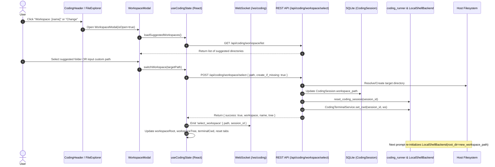

# Shield AI: Dynamic Workspace Selection & Filesystem Backend

## 1. Overview

In the Shield AI Coding Agent, users can dynamically select and switch the active **Workspace Folder** where the Deep Agent's filesystem backend (`LocalShellBackend`) reads, edits, creates, and executes code.

This allows developers to point the autonomous coding agent directly to:
1. **Default Sandbox (`workspace/users/{user_id}/code`)**: An isolated scratchpad directory per user.
2. **Current Project Repository (`d:/sih/project`)**: The active host repository codebase for directly developing on the application.
3. **User Project Subdirectories (`workspace/users/{user_id}/projects/{project_name}`)**: Dedicated per-project directories.
4. **Any Custom Absolute or Relative Directory**: Any directory on the filesystem (e.g. `C:/dev/my-app` or a new folder name created on demand).

---

## 2. Architecture & Data Flow



---

## 3. Backend Implementation Details

### A. Workspace Resolver (`backend/app/services/coding_workspace.py`)
- **`resolve_workspace_dir(user_id, custom_path=None, create_if_missing=True) -> Path`**:
  - If `custom_path` is empty or None: falls back to user default sandbox (`workspace/users/{user_id}/code`).
  - If `custom_path` is relative (e.g. `web-app`): resolved inside `workspace/users/{user_id}/projects/web-app`.
  - If `custom_path` is absolute (e.g. `D:/sih/project`): resolves directly to the host directory.
  - Automatically creates missing directories if `create_if_missing=True`.
- **`list_suggested_workspaces(user_id) -> List[Dict]`**:
  - Scans user directories and host project repository root.
  - Returns metadata: `name`, `path`, `type` (`default`, `project_root`, `user_project`), and `description`.

### B. Workspace Selection Endpoints (`backend/app/routers/coding.py`)
- **`GET /api/coding/workspace/list`**: Returns suggested workspace list.
- **`POST /api/coding/workspace/select`**:
  - Resolves target path.
  - Updates `CodingSession.workspace_path` in SQLite.
  - Calls `reset_coding_session(session_id)` to evict cached in-memory agent instances.
  - Calls `CodingTerminalService.set_cwd(session_id, ws)` so the terminal immediately points to the new root.
  - Returns recursive file tree of the newly selected directory.
- **WebSocket `select_workspace` message**:
  - Receives `{ type: "select_workspace", path, session_id }`.
  - Re-mounts workspace and broadcasts `workspace_selected` event with the fresh directory tree.

### C. Deep Agent Integration (`backend/app/services/coding_runner.py`)
- When `reset_coding_session(session_id)` is invoked, `_coding_sessions[session_id]` is cleared.
- On the next agent prompt:
  ```python
  session = CodingAgentSession(
      session_id,
      user_id=user_id,
      workspace_dir=ws, # Root directory pointing to the selected workspace!
      model=model,
      hitl_mode=hitl_mode
  )
  ```
- Deep Agents initializes:
  ```python
  backend = LocalShellBackend(root_dir=self.workspace_dir)
  self.agent = create_deep_agent(backend=backend, model=..., ...)
  ```
- All Deep Agent tools (`write_file`, `edit_file`, `read_file`, `execute`, `ls`, etc.) write and execute code directly in the user-selected workspace.

---

## 4. Frontend UI Implementation

### A. Interactive Header Pill (`frontend/src/components/coding/CodingHeader.jsx`)
- The `Workspace: [folderName]` pill in the top navigation bar is now an interactive button with a hover gradient, chevron icon, and tooltip:
  - *“Click to select or switch workspace directory (where the agent writes code)”*
- Clicking opens the `WorkspaceModal`.

### B. File Explorer Direct Folder Selection (`frontend/src/components/coding/FileExplorer.jsx`)
- **Header Toolbar Button (`FolderInput`)**: Right next to "New File" and "Refresh", a dedicated "Open / Select Workspace Folder" button allows launching the folder picker immediately.
- **Tree Node Folder Actions (`FileTreeNode`)**: Every folder item in the tree displays a hover action icon (`FolderInput`) with the tooltip *"Open '[folder]' as Workspace"*. Clicking this on any folder immediately scopes the agent, file tree, terminal, and filesystem backend into that subfolder!
- **Parent Up Navigation (`CornerLeftUp`)**: In the active workspace header row, an **"Up"** button allows developers to step up to the parent directory on disk with a single click.
- **Change Workspace Link**: Direct button to open the full workspace selector modal.

### C. Interactive Filesystem Browser Modal (`frontend/src/components/coding/WorkspaceModal.jsx`)
- **Dual Mode Tabs**:
  1. **"Browse Filesystem"**: Live interactive folder browser showing drives (`C:/`, `D:/`), clickable breadcrumb paths, parent directory navigation (`..`), and single-click folder selection. Includes an **"OS Picker..."** option utilizing `window.showDirectoryPicker()`.
  2. **"Suggested & Custom Path"**: Quick one-click selection of pre-configured workspaces (Sandbox, Host Project Repo, User Projects) plus custom path creation.
- **Instant Mounting**: Selecting any directory immediately informs the backend, re-initializes Deep Agent tools, resets editor tabs, and loads the new file tree.

### D. State Management (`frontend/src/hooks/useCodingState.js`)
- `switchWorkspace(targetPath)`: Calls the REST API and WebSocket, updates `workspaceRoot`, reloads `workspaceTree`, resets `terminalCwd`, clears stale open editor tabs, and refreshes git status.
- `availableWorkspaces`: Reactive list of suggested workspaces refreshed automatically whenever a new directory is mounted.
